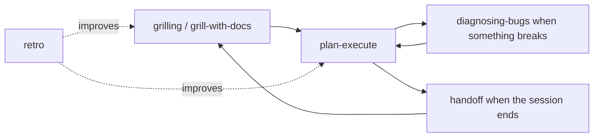

# Snow App Skills

Small, composable agent skills for [Snow App](https://github.com/zhaoxuya520/snow-app). Each skill does one job, uses Snow App's native tools, and can be combined with the others.

## Principles

- Small and composable. One skill, one job.
- Facts belong to the agent, decisions belong to the user.
- No silent assumptions and no one-shot refactors.
- Verify against real code and real logs, never against guesses.
- Write down what was decided, so the next session does not rediscover it.

## Skills

| Skill | Trigger | What it does |
| --- | --- | --- |
| [`grilling`](skills/grilling/SKILL.md) | "grill me", "pressure-test this plan" | Design-tree interview in rounds, each question with a recommended answer, until the frontier is empty |
| [`grill-me`](skills/grill-me/SKILL.md) | Explicit "grill me" | Alias entry that loads `grilling` |
| [`grill-with-docs`](skills/grill-with-docs/SKILL.md) | A plan that must be written down | Grilling plus glossary and ADR upkeep in the repository |
| [`plan-execute`](skills/plan-execute/SKILL.md) | "start executing this plan", "refactor this module" | Freeze batches and gates, track them in the todo list, implement and verify batch by batch |
| [`diagnosing-bugs`](skills/diagnosing-bugs/SKILL.md) | A bug or performance regression | Reproduce, narrow the layer, instrument, fix the root cause, verify |
| [`handoff`](skills/handoff/SKILL.md) | Session ending, another agent continues | Compact state, decisions and next step into a handoff document |
| [`retro`](skills/retro/SKILL.md) | "retro", "what should we improve" | Propose prioritized improvements to the agent environment after a session |

## Recommended flow



`grilling` settles the decisions, `plan-execute` builds them in gated batches, `diagnosing-bugs` handles failures, `handoff` carries state across sessions, and `retro` improves the environment.

## Installation

### Snow App

1. Open **Settings -> Skills**.
2. Install from GitHub with repository `BaSui01/snow-app-skills` and the subdirectory `skills/<skill-name>`.
3. Enable the skill and refresh the tool list.

Or copy a folder into one of the scanned directories:

```text
~/.snow/skills/<skill-name>/SKILL.md        # available in every project
<project>/.snow/skills/<skill-name>/SKILL.md # project only
```

### Frontmatter

Snow App parses only these fields:

```yaml
---
name: skill-name
description: When to use it and what it produces.
enable: true
allowed-tools:
  - filesystem-read
---
```

`disable-model-invocation` and `agents/openai.yaml` belong to other agents; Snow App ignores them. If a skill must only run on explicit request, say so in the description.

## Portability

The bodies use Snow App tool names (`skills-skill-execute`, `user-interaction-askUserQuestion`, `todo-todo-manage`, `memory-search`, `memory-save`, `config-logs-read`). On other agents, map them to the equivalents: interactive question tool, todo list, memory store, log reader. The rules themselves are platform-neutral.

## Contributing

Keep skills short, write them in English, and do not encode one machine's paths or secrets. Run the positive, negative and permission-boundary checks described in the Snow App skill authoring guide before opening a pull request.
