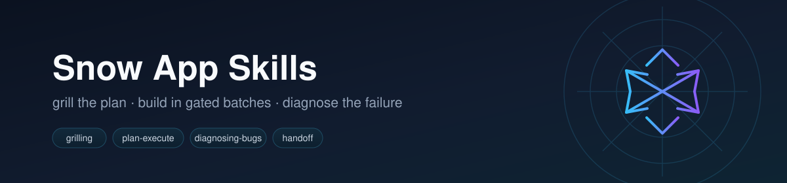
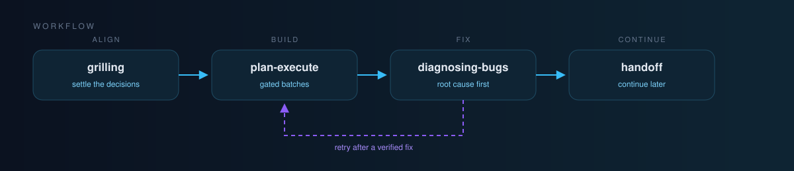

<div align="center">



**Small, composable agent skills for [Snow App](https://github.com/MayDay-wpf/snow-app).**

[](https://github.com/BaSui01/snow-app-skills/actions/workflows/validate.yml)
[](LICENSE)


**English** | [简体中文](README.zh-CN.md)

</div>

---

Most agent failures are not model failures. They are alignment failures, verification failures, and context failures. These skills attack those three directly: settle the decisions first, build in small gated batches, diagnose before fixing, and leave a handoff when the session ends.

## Flow



See [WORKFLOW.md](WORKFLOW.md) for three end-to-end recipes and the exact prompts to use at each step.

| Stage | Skill | You get |
| --- | --- | --- |
| Align | `grilling` / `grill-me` | Every design branch decided by you before code exists |
| Align + write down | `grill-with-docs` | The same interview, plus `GLOSSARY.md` and ADRs |
| Build | `plan-execute` | Frozen batches, a todo list, per-batch gates, recorded results |
| Fix | `diagnosing-bugs` | Root cause with evidence, minimal fix, verification |
| Continue later | `handoff` | State, decisions, open questions and the next first step |
| Improve | `retro` | Prioritized fixes to rules, checks, skills and tooling |

## Skills

| Skill | Trigger | What it does |
| --- | --- | --- |
| [`grilling`](skills/grilling/SKILL.md) | "grill me", "pressure-test this plan" | Design-tree interview in rounds, one question set at a time, each with a recommended answer |
| [`grill-me`](skills/grill-me/SKILL.md) | Explicit "grill me" | Alias entry that loads `grilling` |
| [`grill-with-docs`](skills/grill-with-docs/SKILL.md) | A plan worth writing down | Grilling plus glossary and ADR upkeep |
| [`plan-execute`](skills/plan-execute/SKILL.md) | "start executing this plan", "refactor this module" | Batch freeze, todo tracking, per-batch gates |
| [`diagnosing-bugs`](skills/diagnosing-bugs/SKILL.md) | A bug or performance regression | Reproduce, narrow the layer, instrument, fix the root cause |
| [`handoff`](skills/handoff/SKILL.md) | Session ending, another agent continues | Compact state, decisions and next step |
| [`retro`](skills/retro/SKILL.md) | "retro", "what should we improve" | Environment improvements, most severe first |

## Recommended sets

Do not install all seven by default; the descriptions compete in the skill list.

| Set | Skills | Use when |
| --- | --- | --- |
| Minimal | `grilling`, `plan-execute` | Most feature work |
| Debugging | `grilling`, `plan-execute`, `diagnosing-bugs` | You also chase bugs |
| Docs-heavy | `grilling`, `grill-with-docs`, `plan-execute`, `retro` | Design decisions must be recorded |
| Full | all seven | You want the whole loop and accept the extra descriptions |

## Install

### Snow App

1. Open **Settings → Skills**.
2. Choose to install from GitHub.
3. Repository: `BaSui01/snow-app-skills`
4. Subdirectory: `skills/<skill-name>` (for example `skills/plan-execute`).
5. Enable it, then refresh the tool list.

The install record pins a commit SHA. Reinstall to pick up updates.

### Manual

```bash
git clone https://github.com/BaSui01/snow-app-skills.git
cp -r snow-app-skills/skills/plan-execute ~/.snow/skills/
```

Global skills live in `~/.snow/skills/<name>`; project-only skills live in `<project>/.snow/skills/<name>`.

## Compatibility

Snow App parses only these frontmatter fields:

```yaml
---
name: skill-name
description: When to use it and what it produces.
enable: true
allowed-tools:
  - filesystem-read
---
```

`disable-model-invocation` and `agents/openai.yaml` belong to other agents and are ignored by Snow App. A skill that must only run on explicit request says so in its description. The bodies use Snow App tool names (`skills-skill-execute`, `user-interaction-askUserQuestion`, `todo-todo-manage`, `memory-search`, `memory-save`); on other agents, map them to the local equivalents.

## Validation

CI runs `scripts/validate-skills.mjs` on every push and pull request. It checks that:

- every `skills/*/SKILL.md` has closed frontmatter with `name` and `description`;
- `name` matches the folder id;
- the description is long enough to be a trigger and under 600 characters;
- every skill is linked from `README.md` and, when present, `README.zh-CN.md`;
- no absolute machine paths or obvious credentials slipped in.

Run it locally:

```bash
node scripts/validate-skills.mjs
```

## Versioning

Releases follow Semantic Versioning. Tags mark installable states; Snow App's GitHub install pins a commit SHA, so reinstall after a release to update. See [CHANGELOG.md](CHANGELOG.md).

## Repository layout

```text
snow-app-skills/
├── .github/
│   ├── ISSUE_TEMPLATE/
│   ├── PULL_REQUEST_TEMPLATE.md
│   └── workflows/
│       ├── release.yml
│       └── validate.yml
├── assets/
│   ├── banner.svg
│   └── flow.svg
├── scripts/
│   └── validate-skills.mjs
├── skills/
│   └── <skill-name>/
│       └── SKILL.md
├── templates/
│   └── skill/
│       └── SKILL.md
├── CHANGELOG.md
├── CONTRIBUTING.md
├── LICENSE
├── README.md
├── README.zh-CN.md
└── WORKFLOW.md
```

## Contributing

Issues and pull requests are welcome. Read [CONTRIBUTING.md](CONTRIBUTING.md) first: skills must stay small, generic, English, and free of machine-specific paths or secrets.

## License

[MIT](LICENSE)
