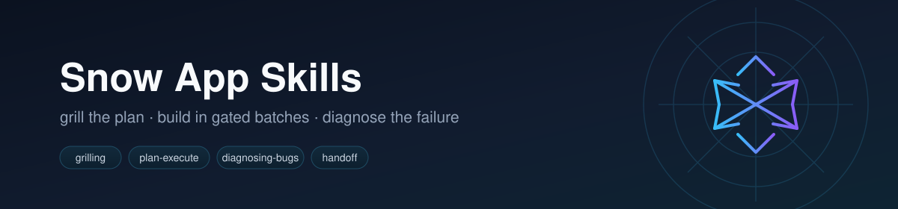
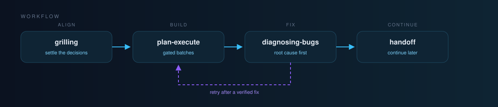

<div align="center">



**面向 [Snow App](https://github.com/MayDay-wpf/snow-app) 的小型、可组合 Agent 技能。**

[](https://github.com/BaSui01/snow-app-skills/actions/workflows/validate.yml)
[](LICENSE)


[English](README.md) | **简体中文**

</div>

---

多数 Agent 失败不是模型能力问题，而是三件事：没对齐、没验证、没上下文。这些技能分别处理：先把决策问清，再按批次小步实现，出错先定位根因，会话结束留下交接。

## 工作流



三条完整配方与每一步可直接照抄的提示词见 [WORKFLOW.md](WORKFLOW.md)。

| 阶段 | 技能 | 产出 |
| --- | --- | --- |
| 对齐 | `grilling` / `grill-me` | 写代码之前，由你拍板每一条设计分支 |
| 对齐并留档 | `grill-with-docs` | 同样的拷问，外加 `GLOSSARY.md` 与 ADR |
| 实现 | `plan-execute` | 冻结批次、待办清单、每批门禁、结果记录 |
| 修复 | `diagnosing-bugs` | 有证据的根因、最小修复、验证结果 |
| 下次继续 | `handoff` | 状态、决策、未决问题和下一步第一个动作 |
| 改进 | `retro` | 按严重程度排序的环境改进建议 |

## 技能

| 技能 | 触发场景 | 做什么 |
| --- | --- | --- |
| [`grilling`](skills/grilling/SKILL.md) | 「grill 我」「压测这个方案」 | 按设计树逐轮提问，一次问完已解锁的问题，每题附推荐答案 |
| [`grill-me`](skills/grill-me/SKILL.md) | 明确说「grill me」 | 别名入口，加载 `grilling` |
| [`grill-with-docs`](skills/grill-with-docs/SKILL.md) | 方案值得写下来 | 拷问的同时维护术语表与 ADR |
| [`plan-execute`](skills/plan-execute/SKILL.md) | 「开始执行这个计划」「重构这个模块」 | 冻结批次、跟踪待办、每批门禁 |
| [`diagnosing-bugs`](skills/diagnosing-bugs/SKILL.md) | 缺陷或性能回退 | 复现、收窄层级、插桩、定位根因 |
| [`handoff`](skills/handoff/SKILL.md) | 会话结束，换 Agent 继续 | 压缩状态、决策与下一步 |
| [`retro`](skills/retro/SKILL.md) | 「复盘」「有什么可改进」 | 环境改进建议，最严重的排在前面 |

## 推荐组合

不要默认全装，七个技能的 description 会在技能列表里互相竞争。

| 组合 | 技能 | 适用 |
| --- | --- | --- |
| 最小 | `grilling`、`plan-execute` | 大多数功能开发 |
| 调试 | `grilling`、`plan-execute`、`diagnosing-bugs` | 需要同时查 bug |
| 重文档 | `grilling`、`grill-with-docs`、`plan-execute`、`retro` | 设计决策必须留档 |
| 完整 | 全部七个 | 想要完整闭环，接受额外描述 |

## 安装

### Snow App

1. 打开 **Settings → Skills**。
2. 选择从 GitHub 安装。
3. 仓库填 `BaSui01/snow-app-skills`。
4. 子目录填 `skills/<技能名>`，例如 `skills/plan-execute`。
5. 启用后刷新工具列表。

安装记录会固定一个 commit SHA，更新需要重新安装。

### 手动拷贝

```bash
git clone https://github.com/BaSui01/snow-app-skills.git
cp -r snow-app-skills/skills/plan-execute ~/.snow/skills/
```

全局技能放在 `~/.snow/skills/<name>`；仅当前项目使用的技能放在 `<project>/.snow/skills/<name>`。

## 兼容性

Snow App 只解析以下 frontmatter 字段：

```yaml
---
name: skill-name
description: When to use it and what it produces.
enable: true
allowed-tools:
  - filesystem-read
---
```

`disable-model-invocation` 和 `agents/openai.yaml` 属于其他 Agent，Snow App 会忽略。需要「仅显式触发」的技能，只能在 description 里写清触发条件。技能正文使用 Snow App 的工具名（`skills-skill-execute`、`user-interaction-askUserQuestion`、`todo-todo-manage`、`memory-search`、`memory-save`）；换到其他 Agent 时，映射到对应工具即可。

## 校验

CI 在每次 push 和 PR 时运行 `scripts/validate-skills.mjs`，检查：

- 每个 `skills/*/SKILL.md` 的 frontmatter 闭合，且包含 `name` 与 `description`；
- `name` 与目录名一致；
- description 足够长、能作为触发条件，且不超过 600 字符；
- 每个技能都被 `README.md` 链接，存在 `README.zh-CN.md` 时也必须链接；
- 没有混入绝对路径或明显的凭据。

本地运行：

```bash
node scripts/validate-skills.mjs
```

## 版本

版本遵循 Semantic Versioning。Tag 标记可安装状态；Snow App 的 GitHub 安装会固定 commit SHA，因此升级后需要重新安装。变更记录见 [CHANGELOG.md](CHANGELOG.md)。

## 仓库结构

```text
snow-app-skills/
├── .github/
│   ├── ISSUE_TEMPLATE/
│   ├── PULL_REQUEST_TEMPLATE.md
│   └── workflows/
│       ├── release.yml
│       └── validate.yml
├── assets/
│   ├── banner.svg
│   └── flow.svg
├── scripts/
│   └── validate-skills.mjs
├── skills/
│   └── <skill-name>/
│       └── SKILL.md
├── templates/
│   └── skill/
│       └── SKILL.md
├── CHANGELOG.md
├── CONTRIBUTING.md
├── LICENSE
├── README.md
├── README.zh-CN.md
└── WORKFLOW.md
```

## 贡献

欢迎提 Issue 和 PR。先读 [CONTRIBUTING.md](CONTRIBUTING.md)：技能必须保持单一职责、通用、英文，且不包含本机路径或密钥。

## 许可证

[MIT](LICENSE)
