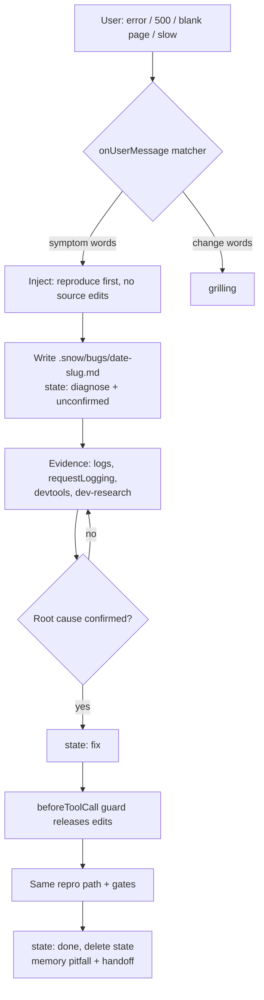

# Workflow

The skills do not orchestrate themselves. You drive the chain, one stage at a time. Each recipe names the skill, the words that trigger it automatically, and the artifact you should get before moving on.

## Automation layers

Snow App can trigger, inject, block and verify. It cannot make decisions.

| # | Mechanism | What it guarantees | What it does not |
| --- | --- | --- | --- |
| 1 | Skill `description` | The skill is likely selected when the user's words match | A 100% trigger; the body is not read until the skill loads |
| 2 | `onUserMessage` hook (`context` / `command`, `matcher`) | Deterministic text injected before the model answers | Compliance; it is prompt text |
| 3 | `beforeToolCall` / `toolConfirmation` hook (`exit 2`) | A specific tool call is actually stopped | A sandbox: bash can still write files, and a hook that errors is skipped |
| 4 | `acceptance` + `onSubAgentComplete` (`exit 2` replaces the summary) | A sub-agent result without evidence is rejected | Evidence relevance; the parent still checks |
| 5 | Goal Mode + todo | A mechanical remainder continues until the todos finish or the budget runs out | The budget is set by the user in the plus menu; the AI cannot set it |

Two consequences:

- Put trigger words and negative scope into `description`. `## When not to use` lives in the body, which is invisible until the skill loads.
- Only layers 3 and 4 are enforcement. Everything else is guidance, and hooks fail open.

## The debug loop

This is the one chain that needs no product decisions, so it is the one worth automating end to end.



1. **Trigger** - `diagnosing-bugs` is described with the symptom words users actually type. The `onUserMessage` hook repeats the hard rule even when the skill was not loaded.
2. **Reproduce** - write the bug note and `.snow/workflow-state.json`. This file is the anchor the guard reads.
3. **Evidence** - `config-manage action=logs`, a short `requestLogging` window, `browser-devtools` console and network, `terminal-read`, and `dev-research` for call chains. Give every research sub-agent an `acceptance` list.
4. **Block** - while `phase` is `diagnose` and `rootCause` is `unconfirmed`, `beforeToolCall` rejects `filesystem-replace_edit`, `filesystem-create` and `filesystem-copy`. Paths under `.snow/` stay writable so the note itself can be written.
5. **Fix** - set `phase` to `fix`, apply the smallest change, rerun the same reproduction plus the gates.
6. **Close** - `phase` to `done`, delete the state file, save the pitfall, hand off when the session ends.

State contract:

```json
{"recipe":"debug","phase":"diagnose|fix|done","rootCause":"unconfirmed|confirmed","bugNote":".snow/bugs/<date>-<slug>.md"}
```

Only the agent writes this file. A stale `diagnose` state blocks edits, so `handoff` records it and deletes it.

## The feature loop

```text
grilling (+ decision-notes when the decisions must be kept) -> plan-execute -> Goal Mode for the mechanical remainder -> acceptance -> user confirms the commit
```

- **Trigger** - both skills carry the words users actually say: "should we", "how should we", "build it", "refactor this module".
- **Never automate** the interview, the plan approval or the per-batch gate. Goal Mode starts only after the batches and acceptance are frozen, with a finite budget.
- **Delegate only non-overlapping batches** and pass an explicit `acceptance` list. The native sub-agent budget is 128 model requests / 30 active minutes; a batch larger than that fails and is not resumed automatically.
- **Verify** every renderer batch with `ui-verification`: console and network clean, layout judged by `getBoundingClientRect` / `getComputedStyle`, before/after screenshots on the same path.

## Decision notes

Non-trivial decisions live in the repository, not only in the conversation: `.agents/notes/{proposed,implemented,rejected,archived}/{feature,bug-fix,simplification,architecture,process,testing}/YYYY-MM-DD-topic.md`. The `decision-notes` skill owns the format, templates and check; the other skills only decide when to call it.

- A non-trivial change writes or updates its note in the same commit: `proposed` before the work, `implemented` when it lands, `rejected` with a reason, `archived` frozen.
- The proposed note is the plan of record: `plan-execute` writes `## Execution batches` into it, the parent agent owns the status column, and sub-agents receive only their batch row and never edit the note.
- The path is the state. No index file.
- `memory` keeps a one-line pointer; the note is the record.
- Mechanical edits (formatting, rename, styling, tag, CRUD, behavior-neutral dependency patch) get no note.
- Gate: `node <skill-path>/scripts/verify-notes.mjs` from the repository root; this repository uses `node scripts/verify-notes.mjs` and CI runs it.

## Recipe 1: Build a feature

| Step | Skill | Trigger / manual prompt | Artifact |
| --- | --- | --- | --- |
| 1. Align | `grilling` | "Grill me on <feature>. Ask the whole frontier, one round at a time, and recommend an answer for each question." | Settled decisions, remaining risks, dropped alternatives |
| 2. Write it down | `decision-notes` | Only when durable decisions must be recorded: "Grill me on this design and record the settled decisions." | Proposed note under `.agents/notes/`, `GLOSSARY.md`, updated docs |
| 3. Freeze | `plan-execute` | "Freeze the batch plan and start executing. Stop at the first gate failure." | Batch table inside the note, todo list, gate output per batch, acceptance receipts |
| 4. Verify UI | `ui-verification` | Only when the batch renders: "Verify the layout against the numbers, not the screenshot." | Before/after geometry, screenshots, clean console and network |
| 5. Hand off | `handoff` | "Write a handoff for the next session." | State, open questions, next first step |

The prompts are the manual fallback. The same words in conversation trigger the skill through its `description`; do not paste a prompt when the request already says it.

Stop if step 1 ends with unresolved decisions: do not start step 3. Skip step 2 unless an ADR or glossary entry is actually required; running the same interview twice adds no decisions.

## Recipe 2: Fix a bug

| Step | Skill | Trigger / manual prompt | Artifact |
| --- | --- | --- | --- |
| 1. Diagnose | `diagnosing-bugs` | "Diagnose <symptom>. Reproduce, narrow the layer, and do not change code until the root cause is confirmed." | Bug note, state file, evidence chain, root cause, verification loop |
| 2. Fix | `plan-execute` | "Execute the fix in gated batches. The root cause is confirmed." | Minimal fix, gate output, regression evidence |
| 3. Record | `diagnosing-bugs` note / `handoff` | "Record the root cause and hand off." | `implemented/bug-fix` note, memory pointer, handoff document |

Stop if the root cause is still a hypothesis: do not apply a fix to see whether it helps. The state file and the write guard enforce this, not the prompt.

## Recipe 3: Refactor with decisions

| Step | Skill | Trigger / manual prompt | Artifact |
| --- | --- | --- | --- |
| 0. Isolate | WorkTree mode | Enable WorkTree mode and bind this recipe to its own worktree | A worktree with a single editing session |
| 1. Align and document | `grilling` + `decision-notes` | "Grill me on this refactor and write the decisions into `.agents/notes/` and `GLOSSARY.md`." | Proposed architecture note, glossary entries, migration boundaries |
| 2. Execute | `plan-execute` | "Freeze the refactor into batches and execute them in order. Never start two batches that touch the same file." | Batch table, gates, recorded results, acceptance receipts |
| 3. Review | `retro` | "Run a retro on this session and propose the smallest environment improvements." | Prioritized improvements, applied only after confirmation |

Stop if a batch cannot be verified independently: split it before starting. One worktree, one editing session: parallel batches go to separate worktrees, never to two agents in the same one.

## Setup: the hooks

Write these as global hooks with `config-manage action=set scope=hooks key=<hookType> projectId=""`, then read them back and confirm every action has `"enabled": true`.

`onUserMessage` classifies each incoming message with the workflow script and injects the matching instruction; a message that matches neither pattern produces no output:

```json
{
  "rules": [
    {
      "description": "Route symptom and change messages into the matching workflow",
      "hooks": [
        {
          "type": "command",
          "command": "node \"<repo>/scripts/snow-workflow-hook.mjs\" classify",
          "timeout": 3000,
          "enabled": true
        }
      ]
    }
  ]
}
```

`beforeToolCall` and `onSubAgentComplete` run the workflow script:

```json
{
  "rules": [
    {
      "description": "Block source edits during unconfirmed diagnosis and destructive git",
      "matcher": "toolName:filesystem-replace_edit,toolName:filesystem-create,toolName:filesystem-copy,toolName:bash-*",
      "hooks": [
        {
          "type": "command",
          "command": "node \"<repo>/scripts/snow-workflow-hook.mjs\" guard",
          "timeout": 5000,
          "enabled": true
        }
      ]
    }
  ]
}
```

```json
{
  "rules": [
    {
      "description": "Reject implementation summaries without evidence",
      "hooks": [
        {
          "type": "command",
          "command": "node \"<repo>/scripts/snow-workflow-hook.mjs\" evidence",
          "timeout": 5000,
          "enabled": true
        }
      ]
    }
  ]
}
```

Replace `<repo>` with the absolute path of the installed repository. A hook that errors is skipped, so the guard raises the bar; it is not a security boundary.

## Session boundary

Run `handoff` when the session ends with work still open. The document must name the branch or worktree, the todo state, the decisions already made, the memory entries worth recalling, and the first action of the next session. Do not duplicate diffs or specs; reference them by path. If `.snow/workflow-state.json` exists, record its recipe, phase and root cause in the memo, then delete the file.

## Periodic improvement

Run `retro` after a difficult session, or once a week. It reads `config-manage action=logs`, `usage`, the hook execution records and the effective configuration, then reviews the environment rather than the product: navigation, automated checks, standards, steering files, tool economy, and skills that misfired. Apply changes only after the user confirms.

A scheduled task can run the validator and open an issue when it fails. Create it with `config-manage action=set scope=scheduledTasks key="new"` and use the `createGuidance` returned by `action=list` for the exact fields; if the write is rejected, create it in the panel.

## Skill maintenance

Install, update or uninstall skills through `skill-install`. It verifies the repository, the `SKILL.md` and any script before writing, states the scope (`global`, project, or committed `.agents/skills/`), then reads the installed id back with `config-manage action=list scope=skills`. A bare link is not an install request: summarize it and ask first.

## What can be automated

- **Validation**: every push and pull request runs `validate.yml`.
- **Release**: pushing a `v*` tag runs `release.yml`, which creates the GitHub Release.
- **Gate and acceptance**: `beforeToolCall` and `onSubAgentComplete` can stop a step; `acceptance` receipts record what was actually verified.
- **Decision notes**: `verify-notes` is a non-zero exit code, so a malformed tree, a missing required section or a broken relative link fails the check instead of relying on good intentions.
- **Not automatable**: the grilling interview, plan approval and per-batch gates. They need the user's decisions and one continuous context; do not chain them into a parallel workflow.
- **Rejected automation**: replacing these skills with slash commands. A `customCommands` prompt is just a user message - it does not load the skill body, does not appear in the skill list, and creates a second copy of the instructions that will drift.

## Anti-patterns

- Interviewing and editing at the same time.
- Running `plan-execute` on a plan that is still being debated.
- Diagnosing by trying fixes instead of reproducing the bug.
- Two agents or two batches editing the same file or contract.
- Accepting a sub-agent summary that has no paths, gate output or acceptance evidence.
- Deleting `.snow/workflow-state.json` to get past the write guard instead of confirming the root cause.
- Using `handoff` as a substitute for finishing work that could be finished now.
- Shipping a non-trivial change without a decision note, or keeping two decision systems (`docs/adr` plus `.agents/notes`) at the same time.
- Writing process logs into project docs; docs describe the product, not the session.
